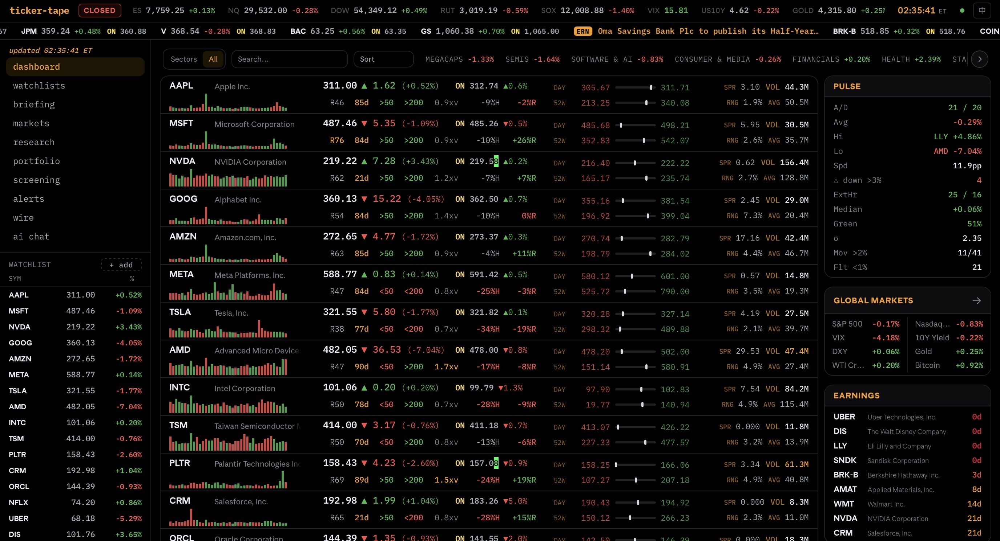
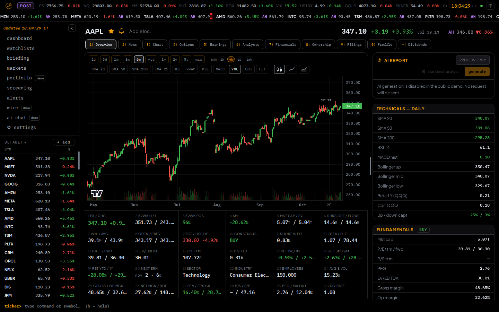
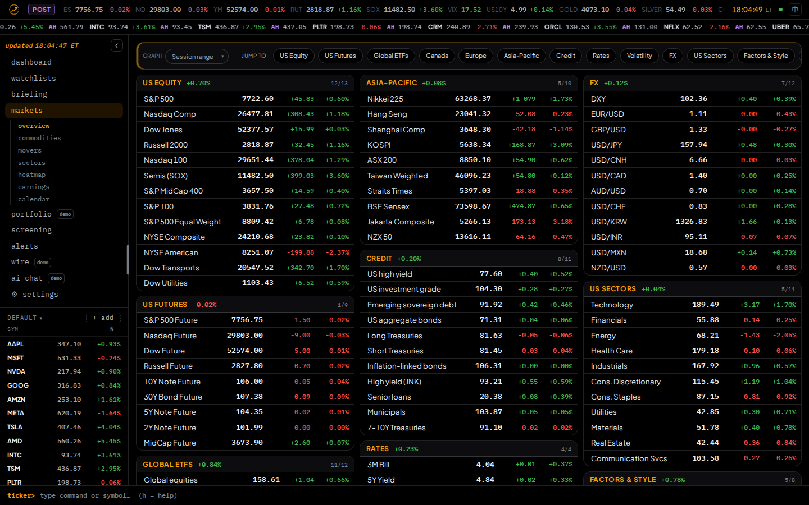
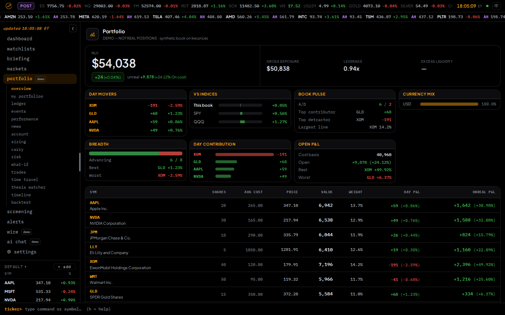
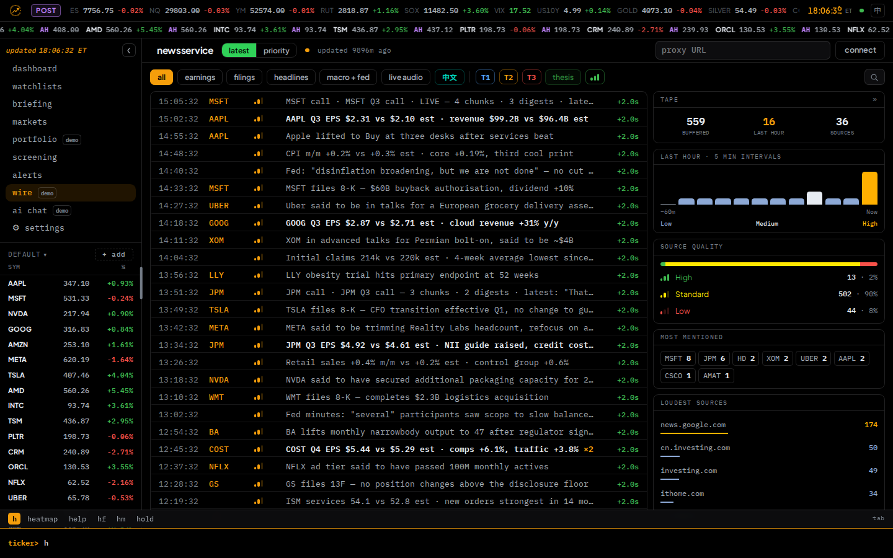
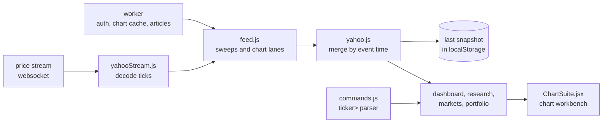

# ticker-tape-web

A keyboard-first market terminal for the browser: live quotes, charts, options, a newswire and portfolio analytics, driven from a command line at the bottom of the screen.

[](https://jeffbai996.github.io/ticker-tape-web/)
[](src/)



The browser holds the live state. A Cloudflare Worker, which is not in this repository, handles Yahoo's cookie and crumb authentication, caches the one-year daily chart at the edge for five minutes, and extracts article text from public English and Chinese publishers under a rate quota. The [live demo](https://jeffbai996.github.io/ticker-tape-web/) uses live prices. Its portfolio, wire and AI chat pages are demos, and AI generation is switched off.

## Screens

| Research | Markets |
| :---: | :---: |
|  |  |
| A candlestick and comparison workbench with SMA, EMA, Bollinger and VWAP overlays, expected-move bands, synced RSI and MACD panes and trendline tools. Tabs cover news, options, earnings, analysts, financials, ownership and SEC filings. | Equities, futures, Asia-Pacific, credit, rates, FX, sectors and factors on one board. Beside it are a sector heatmap, movers ranked by relative volume, and an earnings and macro calendar. |

| Portfolio | Newswire |
| :---: | :---: |
|  |  |
| A synthetic book on live prices: day and unrealized P&L, contribution, concentration and venue splits. Other views cover stress tests, position sizing, carry, what-if trades and backtests of a ledger in more than one currency. | Headlines with filters for earnings, filings, Fed and macro prints, a count by source quality and the most mentioned symbols. The demo's headlines are invented. |

## The command line

Everything is reachable from the `ticker>` prompt:

```
AAPL                             open research
chart AAPL 6m                    chart and technicals
opt AAPL 2026-12-18              options chain for one expiry
vs AAPL MSFT GOOGL               compare
alert AAPL > 400                 arm a price alert
sig add dip rsi<30 above:sma200 vol>1.5
```

The parser is pure. It returns a plan, and the command bar carries the plan out ([`src/lib/commands.js`](src/lib/commands.js)).

## How it is built



## The rest of the app

The full application also has an AI chat and research workspace, an English and Chinese interface, an iOS wrapper built with Capacitor, and a build for Samsung TVs. Tizen 6.5 sets render with Chromium 85. So the TV build lowers the JavaScript and the stylesheet, and it refuses to build if a rule is left that the TV would silently drop.

## Parts worth reading

**One decoder, no runtime.** Yahoo's price stream is JSON whose message field is a base64 protobuf. The app uses one message shape, so a small decoder reads it directly and no protobuf library ships. A closed laptop lid leaves the socket dead while the reconnect timer counts toward 30 seconds. So the stream reconnects at once when the page becomes visible or the network returns ([`src/lib/yahooStream.js`](src/lib/yahooStream.js)).

**The newest event wins.** The REST batch often reports a trade 15 to 60 seconds older than the tick already on screen, and letting it overwrite the price flashed red on a rising tape. So quotes merge by Yahoo's own event timestamps, not by arrival order ([`src/lib/yahoo.js`](src/lib/yahoo.js)).

**Polling follows the tape.** In regular hours the stream carries every print, so the batch is a safety net every 30 seconds. Before and after the session the stream is thin and the extended print is the number people watch, so the batch runs every 15. With the market closed and no overnight session it runs every 120. A hidden tab stops polling. The public stream carries no futures ticks: in a 45-second test there were none, while SPY and AAPL streamed normally. Futures ride the batch, so a futures row sitting still between polls is the cadence, not a stall ([`src/lib/feed.js`](src/lib/feed.js)).

**Charts are fetched three at a time.** A 60-symbol board took about 30 seconds to paint its sparklines one at a time, so three fetches run at once and rows in view go first. The last snapshot is kept in localStorage so a refresh paints at once. It is capped at 60 symbols, because a year of bars is about 14 KB each and going over the quota silently kills persistence for the whole cache.

**Bad bars are dropped.** Yahoo sometimes emits an intraday bar with zero volume and a wick across a third of the price, which flattens the whole chart. A bar goes only if it has no volume and its range is far out of line with its neighbours. A real gap prints volume ([`src/lib/yahoo.js`](src/lib/yahoo.js)).

**A straddle needs one strike.** Picking the nearest call and the nearest put separately can land on two different strikes. Adding their prices then gives a strangle, and the at-the-money volatility is read off two points on the smile. So the expected move, the volatility and the term structure all use the strike nearest spot that is quoted on both sides, when there is one ([`src/lib/optionsIntel.js`](src/lib/optionsIntel.js)):

```js
export function pairedAtmStrike(chain) {
  if (!chain?.spot || !chain.calls?.length || !chain.puts?.length) return null
  const puts = new Set(chain.puts.map((p) => p.strike))
  let best = null
  for (const c of chain.calls) {
    if (!puts.has(c.strike)) continue
    if (best == null || Math.abs(c.strike - chain.spot) < Math.abs(best - chain.spot)) best = c.strike
  }
  return best
}
```

Skew uses Black-Scholes delta on each contract's own quoted volatility. That is a proxy for the exchange's figure, and the code says so. An option is called unusual only when it passes a stated test: at least 500 contracts traded, and either no open interest or three times open interest in volume.

**A screen can say "not yet".** A saved screen is a list of field, operator and value, so it can be typed on a phone and read back in words. A row whose inputs have not arrived is not dropped. It comes back as pending, with the missing fields named, because "no RSI yet" and "RSI 62" are different answers. An alert cannot express an AND of several tests, so arming one picks the closest single condition and says that it did ([`src/lib/screenDefs.js`](src/lib/screenDefs.js)).

**The replay does not look ahead.** A fill counts only once the walk reaches its day, and missing data never produces a number: a missing price carries the last one, and a missing benchmark gives nothing rather than zero. In a mixed USD and CAD book each amount converts at the rate for its own date ([`src/lib/backtest.js`](src/lib/backtest.js)).

## What is in this repository

A handful of modules from a private codebase. It is not runnable on its own.

| File | What it does |
| :--- | :--- |
| [`src/lib/yahooStream.js`](src/lib/yahooStream.js) | The stream decoder and a reconnecting websocket |
| [`src/lib/feed.js`](src/lib/feed.js) | Batch sweeps, chart lanes and the snapshot cache |
| [`src/lib/yahoo.js`](src/lib/yahoo.js) | Quote shapes, merging and bad-bar removal |
| [`src/lib/optionsIntel.js`](src/lib/optionsIntel.js) | Expected move, volatility, term structure and skew |
| [`src/lib/screenDefs.js`](src/lib/screenDefs.js) | Saved screens and how they are evaluated |
| [`src/lib/commands.js`](src/lib/commands.js) | The command parser |
| [`src/lib/backtest.js`](src/lib/backtest.js) | Replay of a fills file against a benchmark |
| [`src/lib/chartmath.js`](src/lib/chartmath.js) | Indicator series for the chart |
| [`src/lib/chartview.js`](src/lib/chartview.js) | Time scale and trendline drawing |
| [`src/components/ChartSuite.jsx`](src/components/ChartSuite.jsx) | The chart workbench |

## Stack

- **Browser:** Preact 10, Vite 8 and Tailwind CSS 4. Charts use TradingView's lightweight-charts 5.1 with custom canvas primitives for trendlines.
- **Worker:** Cloudflare Workers and Durable Objects, with linkedom for article text.
- **Native and TV:** Capacitor 8 for iOS, and a Tizen 6.5 package for Samsung TVs. PostCSS lowers the stylesheet for the TV.
- **Tests:** Vitest 4.

## License

The code is proprietary. See [LICENSE](LICENSE).
