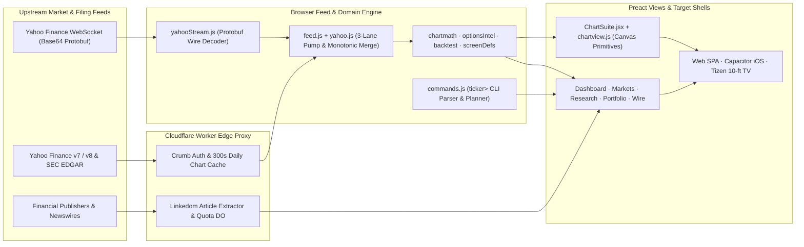

# ticker-tape-web

A keyboard-first market terminal for the browser: live quotes, charts, options, a newswire and portfolio analytics, all driven from a command line at the bottom of the screen.

[](https://jeffbai996.github.io/ticker-tape-web/)
[](src/)


It is a desk terminal's density and keyboard workflow in a client-side web app, on desktop, phone, iOS and a TV. There is no backend database and no market-data SDK: the browser keeps the live state, and a small edge worker handles authentication, caching and article extraction. The [live demo](https://jeffbai996.github.io/ticker-tape-web/) runs on real market data with an invented portfolio.

## Highlights

- Yahoo's price stream is binary protobuf inside base64. A hand-written decoder reads it straight from a `DataView`, with no protobuf runtime.
- Streamed ticks and REST snapshots are merged by the exchange's own timestamps, not arrival order, so a slow snapshot never rewinds a newer print.
- Background chart fetches run on three paced lanes, and the symbols on screen are refreshed first.
- Zero-volume bars with impossible wicks are dropped before they can flatten the chart's price axis.
- The options panel takes the expected move and ATM implied volatility from a strike quoted on both sides, and estimates 25-delta skew with Black-Scholes.
- About 40 terminal verbs parse into plans: research flags, comparisons, inline screens such as `rsi<30 above:sma200 vol>1.5`, and alerts.

## Screenshots

| Research | Markets |
| :---: | :---: |
|  |  |
| Candlestick and comparison workbench with SMA/EMA/Bollinger/VWAP overlays, expected-move bands, synced RSI and MACD panes, trendline drawing tools, and tabs for news, options, earnings, analysts, financials, ownership, and SEC filings. | Equities, index futures, Asia-Pacific, credit, rates, FX, sectors, and factors on a single board, paired with a sector heatmap, relative-volume movers, and an earnings and macro calendar. |

| Portfolio (demo book) | Newswire |
| :---: | :---: |
|  |  |
| Positions, unrealized and day P&L, gross day contribution, Herfindahl concentration, and venue splits, alongside views for stress testing, position sizing, carry, what-if trades, and multi-currency ledger backtests. | Real-time market and company headlines ranked by source quality, with filters for earnings releases, SEC filings, Federal Reserve and macro prints, and bilingual English/Chinese publisher extraction. |

## Architecture



The browser runs the entire state machine. A stateless Cloudflare Worker handles Yahoo v7 cookie/crumb authentication, caches 1-year daily chart series at the edge for 300 seconds, and extracts clean article text from public publishers under a Durable Object rate quota. Inside the client, `feed.js` combines streaming WebSocket ticks from `yahooStream.js` with batched v7 snapshots and 3-lane v8 chart fetches, persisting a 60-symbol LRU snapshot cache in `localStorage` for instant first paint before feeding pure domain modules for charting, options analytics, multi-factor screening, and portfolio replay. The full application also includes a configurable AI research and chat workspace, bilingual English/Chinese localization, a Capacitor iOS wrapper, and a PostCSS downleveling pipeline for Samsung Tizen televisions.

## Inside this repository

| Module | Lines | Responsibility |
| :--- | ---: | :--- |
| [`src/lib/yahooStream.js`](src/lib/yahooStream.js) | 184 | In-tree binary protobuf wire decoder (`decodePricingMessage`) and reconnecting WebSocket client (`createYahooStream`) with subscription diffing and wake-on-visibility recovery. |
| [`src/lib/feed.js`](src/lib/feed.js) | 718 | Live market-data coordinator: coalesced 40-symbol REST batches, 3-lane viewport-prioritized chart pump, session-aware sweep cadences, and custom-proxy circuit breaker. |
| [`src/lib/yahoo.js`](src/lib/yahoo.js) | 239 | Quote normalization, event-timestamp-ordered stream/snapshot merging (`mergeSnapshotQuote`), overnight session labeling, and zero-volume outlier bar filtering (`scrubBadPrints`). |
| [`src/components/ChartSuite.jsx`](src/components/ChartSuite.jsx) | 617 | Multi-pane `lightweight-charts` v5 workbench with synced RSI/MACD panes, normalized symbol comparisons, expected-move price bands, and interactive horizontal/trendline annotations. |
| [`src/lib/chartmath.js`](src/lib/chartmath.js) | 169 | Wilder RSI, SMA-seeded EMA, MACD 12/26/9, Bollinger Bands, warm-up bar prefix padding (`warmedBars`), and clamped point-to-segment trendline hit-testing (`segmentDistance`). |
| [`src/lib/chartview.js`](src/lib/chartview.js) | 149 | Custom `ISeriesPrimitive` canvas trendline renderer (`trendlinePrimitive`), bounded time-scale configuration, New York session time formatting, and CSS zoom coordinate unscaling (`chartHost`). |
| [`src/lib/optionsIntel.js`](src/lib/optionsIntel.js) | 223 | Paired-strike ATM straddle expected move (`expectedMove`), cross-expiry IV term-structure classifier (`ivTermStructure`), 25-delta Black-Scholes skew (`skew25Delta`), and volume/OI outlier scanner. |
| [`src/lib/backtest.js`](src/lib/backtest.js) | 212 | Look-ahead-free realized equity-curve reconstruction (`assembleBacktest`) with daily USD/CAD FX normalization, average-cost partial exits, max drawdown, and benchmark alpha. |
| [`src/lib/screenDefs.js`](src/lib/screenDefs.js) | 350 | Declarative multi-factor screener engine (`evaluateScreen`) with tri-state evaluation (`match`, `pending`, `miss`), human-readable pass/fail proofs, entrant diffing, and alert bridging. |
| [`src/lib/commands.js`](src/lib/commands.js) | 933 | Pure `ticker>` command-line parser (`parseCommand`) and plan describer (`describePlan`) mapping terminal syntax into route transitions, screener definitions, catalysts, and alerts. |

This repository holds selected modules from a private codebase and is not runnable on its own.

## How it works

### Binary protobuf decoding without a runtime dependency

Yahoo Finance's public WebSocket stream sends JSON envelopes whose `message` field is a base64-encoded protobuf payload. Because the terminal only consumes a single fixed message schema (`PricingData`), `src/lib/yahooStream.js` decodes wire tags, 64-bit BigInt varints, ZigZag-encoded timestamps, length-delimited UTF-8 strings, and little-endian IEEE-754 float32 prices directly from a `DataView`:

```js
while (cursor.i < bytes.length) {
  const tag = Number(readVarint(bytes, cursor))
  const field = tag >> 3
  const wire = tag & 7

  if (wire === 0) {
    const value = readVarint(bytes, cursor)
    if (field === 3) tick.time = zigZag(value)
    else if (INTEGER_FIELDS.has(field)) tick[INTEGER_FIELDS.get(field)] = Number(value)
  } else if (wire === 2) {
    const length = Number(readVarint(bytes, cursor))
    if (length < 0 || cursor.i + length > bytes.length) throw new Error('bad protobuf length')
    if (STRING_FIELDS.has(field)) {
      tick[STRING_FIELDS.get(field)] = new TextDecoder().decode(bytes.subarray(cursor.i, cursor.i + length))
    }
    cursor.i += length
  } else if (wire === 5) {
    if (cursor.i + 4 > bytes.length) throw new Error('truncated protobuf float')
    if (FLOAT_FIELDS.has(field)) tick[FLOAT_FIELDS.get(field)] = view.getFloat32(cursor.i, true)
    cursor.i += 4
  }
}
```

### Monotonic quote merging and zero-volume bad-print rejection

Combining a live WebSocket stream with periodic REST batches introduces two failure modes: REST responses often report an exchange timestamp 15 to 60 seconds older than the latest streamed print, and intraday chart feeds occasionally emit zero-volume bars with errant wicks that crush the chart's y-axis. `src/lib/yahoo.js` resolves conflicts using the exchange's own event timestamps and drops zero-volume bars whose high-low range exceeds both 12 times the median traded bar range and 1.5% of price:

```js
export function scrubBadPrints(bars) {
  if (bars.length < 3) return bars
  const range = (b) => Math.max(0, b.high - b.low)
  const traded = bars.filter((b) => (b.volume ?? 0) > 0)
  const pool = (traded.length >= 3 ? traded : bars).map(range).sort((a, b) => a - b)
  const median = pool[Math.floor(pool.length / 2)]
  const scale = bars[Math.floor(bars.length / 2)].close || 1
  const limit = Math.max(median * 12, scale * 0.015)
  return bars.filter((b) => (b.volume ?? 0) > 0 || range(b) <= limit)
}
```

### Paired-strike ATM straddles and options surface skew

Selecting the nearest call strike and nearest put strike independently on an asymmetric options ladder prices a strangle while labeling it a straddle, and introduces artificial strike drift into ATM implied-volatility term structures. `src/lib/optionsIntel.js` intersects the call and put ladders first (`pairedAtmStrike`) so both legs of the expected-move straddle and the ATM IV read share a single strike:

```js
export function pairedAtmStrike(chain) {
  if (!chain?.spot || !chain.calls?.length || !chain.puts?.length) return null
  const puts = new Set(chain.puts.map((p) => p.strike))
  let best = null
  for (const c of chain.calls) {
    if (!puts.has(c.strike)) continue
    if (best == null || Math.abs(c.strike - chain.spot) < Math.abs(best - chain.spot)) best = c.strike
  }
  return best
}
```

## Stack

- **UI and state:** Preact 10, Vite 6, Tailwind CSS 4
- **Charting:** TradingView `lightweight-charts` 5.1 with custom `ISeriesPrimitive` canvas renderers
- **Edge proxy and article extraction:** Cloudflare Workers, Durable Objects, `linkedom`
- **Native and 10-foot targets:** Capacitor 8 (iOS), Samsung Tizen 6.5 web packaging with PostCSS AST downleveling
- **Testing:** Vitest 3

## License

Source code is proprietary. See [LICENSE](LICENSE).
