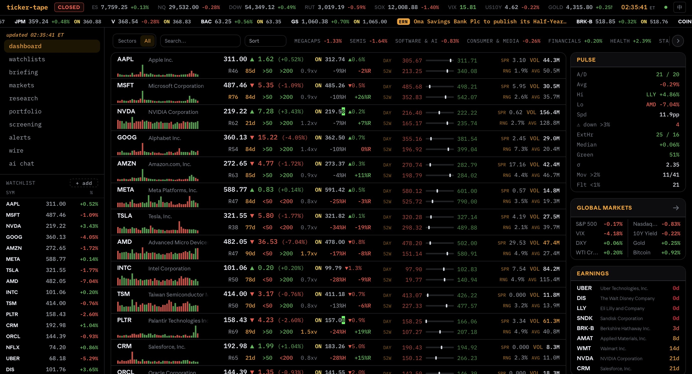

# ticker-tape-web

Market terminal in the browser: streaming quotes, research, markets and portfolio demo views. Preact + Vite + Tailwind v4, static on GitHub Pages, live data through a Cloudflare Worker proxy.

This public demo retains the development history with deployment details and personal fixtures sanitized. Account and portfolio views use synthetic data. Builds always enable demo mode and refuse private credentials or private feature flags.



Live: https://jeffbai996.github.io/ticker-tape-web-demo/ · License: [LICENSE](LICENSE)

## Install

Node 22 is required.

```bash
npm ci
```

## Usage

```bash
npm run dev          # Vite dev server
npm run build        # production build to dist/
npm run budget       # build, fail if the entry chunk is over budget
npm run test:fast    # fast Vitest selection (test/run-tests.mjs)
npm run test:full    # every Vitest suite
npm test -- test/lib/wire_layout.test.js   # one explicit file
npm run probe        # responsive probe gate (scripts/probe_gate.py)
npm run dev:tv       # Samsung Tizen TV: dev server (vite.tv.config.js)
npm run build:tv     # TV production build
npm run package:tv   # package the TV build (scripts/tizen_tv.sh)
npm run ios:sync     # build dist-ios/ and copy into the Xcode project
npm run ios:open     # open ios/App/App.xcodeproj (Mac)
npm run ios:run      # build and launch on a simulator or device
cd worker && npx wrangler deploy   # deploy the Worker (needs Cloudflare credentials)
```

In the app, the footer `ticker>` console takes commands such as `NVDA`, `ta AMD`, `intra TSM`, `vs AAPL MSFT`, `alert SPY > 700`, `w SHOP`.

Pushes to `main` deploy to GitHub Pages (`.github/workflows/deploy.yml`).

iOS needs Xcode 26+ and an iOS 15+ simulator or device; a device needs a signing team. Generated native assets are gitignored and rebuilt by `ios:sync`.

## Configuration

- Worker bindings, vars and observability: `worker/wrangler.toml`.
- Worker secrets are set with `npx wrangler secret put NAME`; never pass them on the command line or commit them.
- Build-time flags are `VITE_*` variables; the Pages build sets `VITE_PUBLIC_DEMO=1` (see `.github/workflows/deploy.yml`).
- Worker routes: Yahoo proxy, `/watchlists`, `/portfolios`, `/wire/*` (`worker/worker.js`).

## Notes

- Tests: Vitest rejects empty, directory and substring selections; name existing `.test.js` / `.spec.js` files.
- The Pages build must not set `VITE_FAMILY_BUILD` or `VITE_SYNC_CAPABILITY`; that would embed a credential in public assets. `test/test_architecture.test.js` fails the build if either appears.
- No personal data in source, fixtures or Pages assets. API keys never reach the browser; public AI controls are inert previews.

## Layout

- `src/` app (`app.jsx`, `pages/`, `components/`, `lib/`)
- `worker/` Cloudflare Worker
- `scripts/` release, probe and backup scripts
- `docs/` engineering notes
- `test/` Vitest suites
- `ios/`, `tv/` native and TV builds
