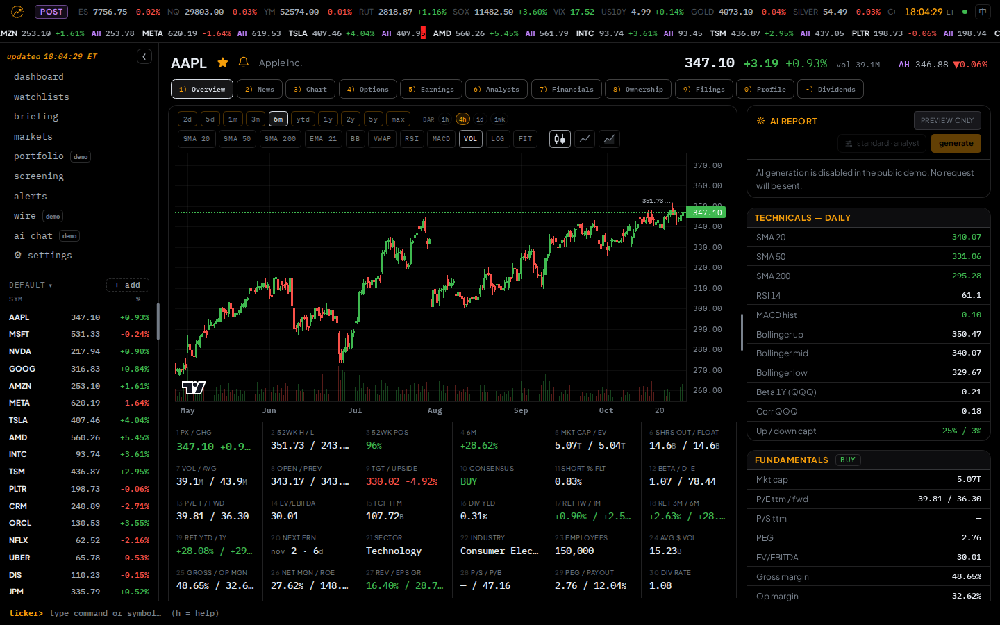
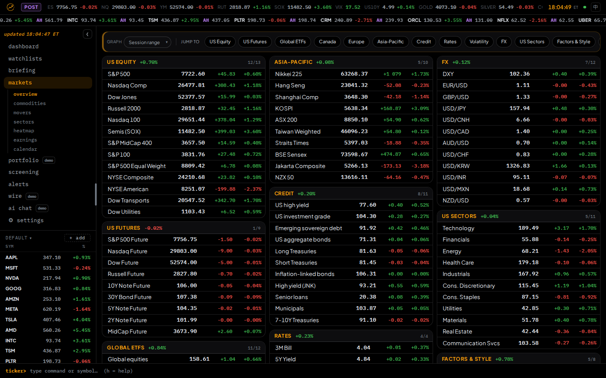
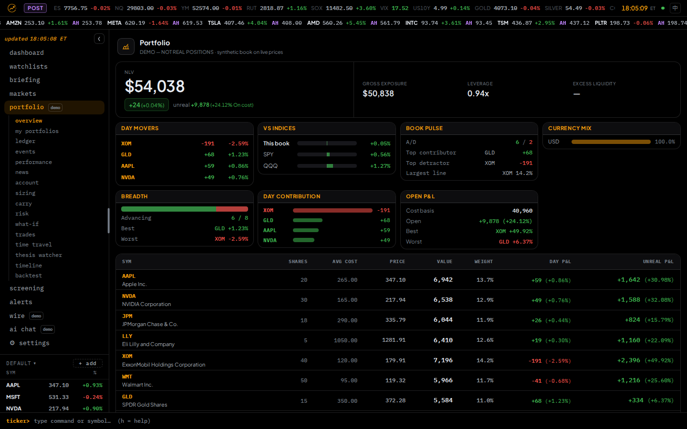
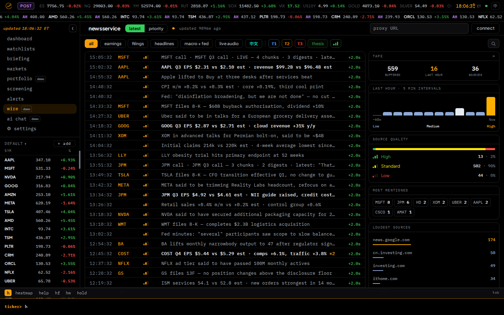

# ticker-tape-web

A market terminal in the browser, after the Bloomberg screen: streaming quotes across asset classes, charts and research pages, a newswire, and portfolio analytics, all driven from a command line at the bottom of the screen.

**[Live demo](https://jeffbai996.github.io/ticker-tape-web/)** runs on live market data with a synthetic portfolio. The source is private; this repository holds the README and screenshots.


## Screens

| Research | Markets |
| :---: | :---: |
|  |  |
| Chart with overlays, technicals and fundamentals; tabs for news, options, earnings, analysts, financials, ownership and filings. | Equities, futures, Asia-Pacific, credit, rates, FX, sectors and factors on one page, with a heatmap, movers and an earnings calendar. |

| Portfolio (demo book) | Newswire |
| :---: | :---: |
|  |  |
| Positions, P&L, day contribution and breadth, plus pages for risk, sizing, carry, what-if, trades and backtests. | Headlines ranked by source quality, with filters for earnings, filings, macro, live call audio and Chinese-language sources. |

## The command line

Every screen has a `ticker>` prompt. Typing a symbol opens its research page; everything else is a short command.

```text
AAPL                      research page
ta AAPL · chart AAPL 6m   chart and technicals, any range
intra MSFT                intraday with VWAP
opt AAPL 2026-12-18       options chain at an expiry
ei MSFT · an MSFT         earnings impact · analysts
vs AAPL MSFT GOOGL        side-by-side comparison
screen AAPL MSFT          valuation grid
m · s · hm · movers       markets, sectors, heatmap, movers
er · cal                  earnings · calendar
pos · acct · corr         portfolio, account, correlation grid
alert AAPL > 400          price alert (also: rsi > 70, vol > 2)
w AAPL · uw AAPL          watch · unwatch
group megacaps AAPL MSFT  name a bucket of symbols
journal add TEXT          trade journal
chat what moved today?    AI chat
lang zh                   switch to Chinese
```

## Notes

- Built with Preact and Vite, charts by TradingView's lightweight-charts, styled with Tailwind.
- One codebase serves desktop, phone and a TV layout, and ships as an iOS app through Capacitor.
- English and Chinese throughout.
- AI chat and AI research reports run against a model of your choice in the full app. They are switched off in the demo, which sends no requests.

---

Source code is proprietary. See [LICENSE](LICENSE).
